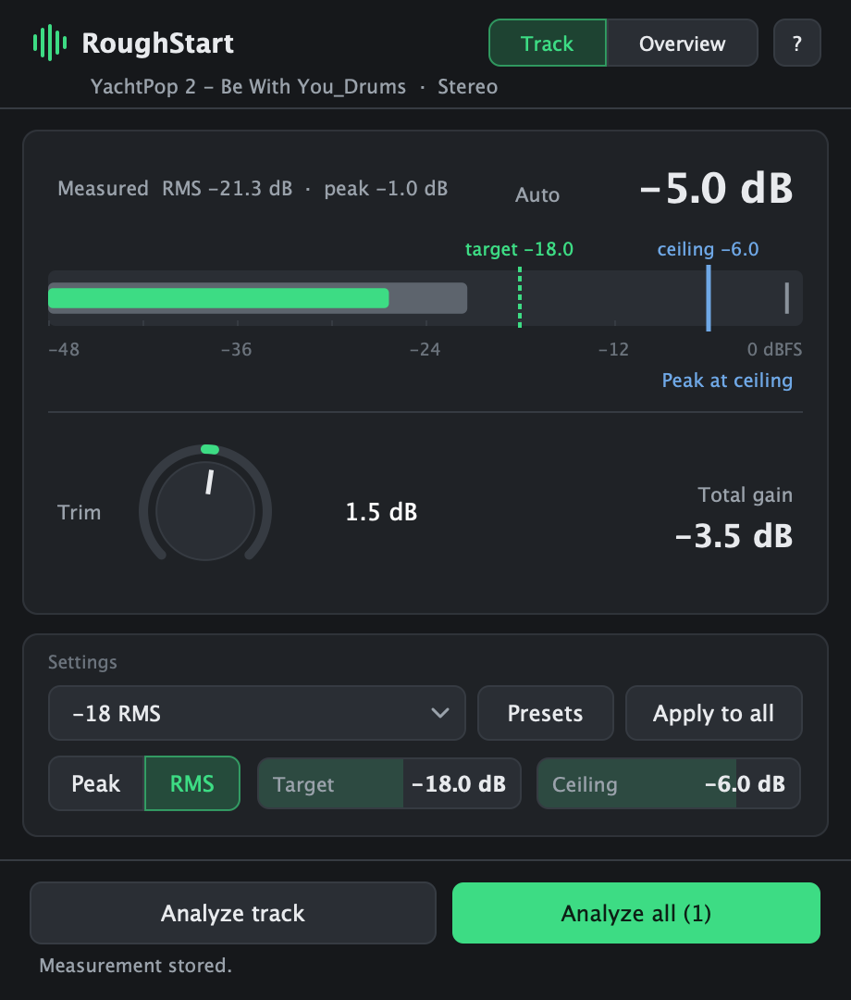

# RoughStart

**Gain staging for every track in your session, in one click.**

RoughStart is a free plug-in for Logic Pro and other DAWs: Audio Unit and VST3 on macOS, VST3 on Windows. Put it first on every track, click **Analyze all**, play the song, and every track lands at the same healthy starting level. Your faders stay at 0 dB, every plug-in after RoughStart gets a sensible input level, and what you hear is already a rough mix. Then you balance by ear with Trim.

It works on software instrument tracks too, which Logic's Normalize Region Gain does not cover.

A hobby project by Ton van der Kolk. Free and open source. The development notes are in Dutch.

Like RoughStart? You can [support it with a coffee](https://buymeacoffee.com/tvdk71).




## Features

- **Analyze all**: every RoughStart instance in the project measures at the same time while the song plays, and stops when playback stops.
- **Peak or RMS** measurement, with a target per mode (default RMS -18 dBFS) and a **peak ceiling** (default -6 dBFS) so punchy material never gets pushed into clipping.
- Silence is ignored: passages below -60 dBFS, and in RMS mode quiet tails more than 20 dB below the average, do not count.
- **Auto** gain is stored with the project (Analyze and hold, no riding). **Trim** is your own adjustment on top, and can be automated.
- **Overview** of every track: level meter, peak, RMS, Auto, Trim and status, with sortable columns. Change Trim for any track right in the table, with its own undo and redo.
- **Presets** for mode, targets and ceiling, including factory presets, your own default for new instances, and import/export.
- Mono and stereo, zero latency, smooth gain changes without clicks, lightweight processing.
- Resizable window (100 to 175%).

## Requirements

- **macOS** 12 or later, Apple Silicon or Intel: Audio Unit and VST3.
- **Windows** 64-bit: VST3. New, and not yet tested in a DAW.
- Developed and tested in **Logic Pro**. Other hosts, such as GarageBand, Ableton Live, Cubase, Studio One, Reaper, Digital Performer and Bitwig, should work too but have not been tested yet. Reports are welcome.

RoughStart finds its other instances inside the host process. Hosts that run each plug-in in a separate sandbox (an option in Bitwig and Reaper) still work per track, but Analyze all and the Overview only see one track.

## Install

**Mac**

Easiest: download the latest `-macos.pkg` from [Releases](https://github.com/tonvanderkolk/roughstart/releases), double-click it and follow the steps. Or by hand:

1. Download the latest `-macos.zip` from [Releases](https://github.com/tonvanderkolk/roughstart/releases) and unzip it.
2. Move `RoughStart.component` to `~/Library/Audio/Plug-Ins/Components` (Finder: Go > Go to Folder...). For VST3 hosts, also move `RoughStart.vst3` to `~/Library/Audio/Plug-Ins/VST3`.
3. RoughStart is signed and notarized by Apple (from version 0.11.1), so no extra steps are needed. Plug-ins installed in `/Library/Audio/Plug-Ins` (without `~`) work too.

4. (Re)start your DAW. In Logic, RoughStart is under Audio Units > TvdK > RoughStart. In Cubase, if an older blocked version is listed in Studio > VST Plug-in Manager, select it and click Reactivate.

**Windows**

1. Download the latest `-windows.zip` from [Releases](https://github.com/tonvanderkolk/roughstart/releases) and extract it.
2. Copy the `RoughStart.vst3` folder to `C:\Program Files\Common Files\VST3`.
3. (Re)start your DAW and rescan plug-ins if needed.

The zip also contains an installation guide and the manual as PDF. The manual is also built into the plug-in: click **?** at the top right.

## Build from source

On macOS you need the Xcode Command Line Tools, CMake and Ninja (`brew install cmake ninja`). On Windows, Visual Studio with C++ and CMake (`cmake -B build -A x64`, then `cmake --build build --config Release`).

```bash
git clone --recurse-submodules https://github.com/tonvanderkolk/roughstart.git
cd roughstart
cmake -B build -G Ninja -DCMAKE_BUILD_TYPE=Release
cmake --build build
```

On macOS the plug-ins are copied to `~/Library/Audio/Plug-Ins` after building. Run the unit tests with `./build/RoughStartTests_artefacts/Release/RoughStartTests` and validate with `auval -v aufx RgSt TvdK`.

`./scripts/package.sh` builds a release zip in `dist/` (needs Google Chrome and the Python `markdown` module for the PDFs).

## About this repository

RoughStart was built with Claude Code. Besides the source in `Source/`, the repository keeps the working notes of that process, in Dutch: `PROJECT.md` (the technical description), `ROADMAP.md` (milestones and decisions) and `CHANGELOG.md` (every version). The manual is `docs/MANUAL.md`; it is also built into the plug-in.

## Feedback and contributions

Questions, ideas and experiences are welcome in [Discussions](https://github.com/tonvanderkolk/roughstart/discussions); bug reports go in [Issues](https://github.com/tonvanderkolk/roughstart/issues). Especially useful: results in DAWs other than Logic, and on Windows.

## License

Copyright (c) 2026 Ton van der Kolk.

RoughStart is free software: you can redistribute it and/or modify it under the terms of the GNU Affero General Public License v3.0. See [LICENSE](LICENSE). RoughStart uses the AGPL rather than a permissive licence because the JUCE framework it is built on requires it for open-source use.

- Built with [JUCE](https://juce.com), used under the AGPL-3.0.
- Uses the [Inter](https://github.com/rsms/inter) typeface, SIL Open Font License 1.1 (`Resources/fonts/Inter-LICENSE.txt`).

RoughStart is provided without any warranty.
