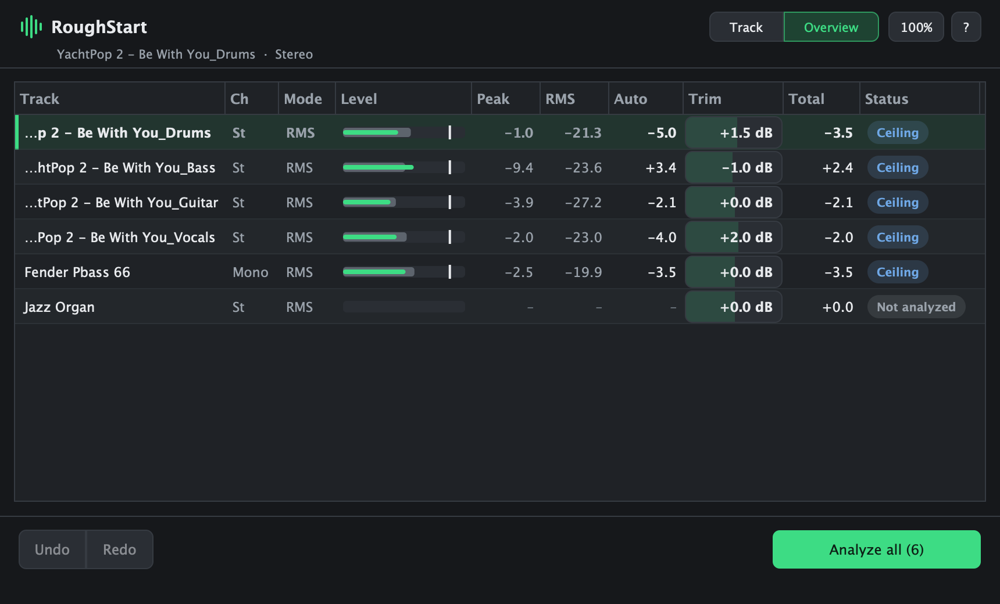

# RoughStart

**Gain staging for every track in your session, in one click.**

RoughStart is a free Audio Unit plug-in for Logic Pro and other Audio Unit hosts on macOS. Put it first on every track, click **Analyze all**, play the song, and every track lands at the same healthy starting level. Your faders stay at 0 dB, every plug-in after RoughStart gets a sensible input level, and what you hear is already a rough mix. Then you balance by ear with Trim.

It works on software instrument tracks too, which Logic's Normalize Region Gain does not cover.




## Features

- **Analyze all**: every RoughStart instance in the project measures at the same time while the song plays, and stops when playback stops.
- **Peak or RMS** measurement, with a target per mode (default RMS -18 dBFS) and a **peak ceiling** (default -6 dBFS) so punchy material never gets pushed into clipping.
- Silence is ignored: passages below -60 dBFS, and in RMS mode quiet tails more than 20 dB below the average, do not count.
- **Auto** gain is stored with the project (Analyze and hold, no riding). **Trim** is your own adjustment on top, and can be automated.
- **Overview** of every track: level meter, peak, RMS, Auto, Trim and status, with sortable columns. Change Trim for any track right in the table, with its own undo and redo.
- **Presets** for mode, targets and ceiling, including factory presets, your own default for new instances, and import/export.
- Mono and stereo, zero latency, smooth gain changes without clicks, lightweight processing.
- Resizable window (100 to 175%).

## Requirements

- macOS 12 or later, Apple Silicon or Intel
- An Audio Unit host on macOS. Developed and tested in **Logic Pro**. Other AU hosts, such as GarageBand, MainStage, Ableton Live, Studio One, Reaper, Digital Performer and Bitwig, should work too but have not been tested yet. Reports are welcome.

RoughStart finds its other instances inside the host process. Hosts that run each plug-in in a separate sandbox (an option in Bitwig and Reaper) still work per track, but Analyze all and the Overview only see one track.

## Install

1. Download the latest zip from [Releases](https://github.com/tonvanderkolk/roughstart/releases) and unzip it.
2. Move `RoughStart.component` to `~/Library/Audio/Plug-Ins/Components` (Finder: Go > Go to Folder...).
3. RoughStart is not yet signed by Apple, so remove the download block once in Terminal:

   ```bash
   xattr -dr com.apple.quarantine ~/Library/Audio/Plug-Ins/Components/RoughStart.component
   ```

4. (Re)start your DAW. In Logic, RoughStart is under Audio Units > TvdK > RoughStart.

The zip also contains an installation guide and the manual as PDF. The manual is also built into the plug-in: click **?** at the top right.

## Build from source

You need the Xcode Command Line Tools, CMake and Ninja (`brew install cmake ninja`).

```bash
git clone --recurse-submodules https://github.com/tonvanderkolk/roughstart.git
cd roughstart
cmake -B build -G Ninja -DCMAKE_BUILD_TYPE=Release
cmake --build build
```

The plug-in is copied to `~/Library/Audio/Plug-Ins/Components` after building. Run the unit tests with `./build/RoughStartTests_artefacts/Release/RoughStartTests` and validate with `auval -v aufx RgSt TvdK`.

`./scripts/package.sh` builds a release zip in `dist/` (needs Google Chrome and the Python `markdown` module for the PDFs).

## Feedback and contributions

Bug reports and ideas are welcome in [Issues](https://github.com/tonvanderkolk/roughstart/issues). Especially useful: results in DAWs other than Logic, and a VST3 or Windows build.

Development notes, the roadmap and the changelog are in Dutch (`ROADMAP.md`, `CHANGELOG.md`, `PROJECT.md`).

## License

RoughStart is free software: you can redistribute it and/or modify it under the terms of the GNU Affero General Public License v3.0. See [LICENSE](LICENSE).

- Built with [JUCE](https://juce.com), used under the AGPL-3.0.
- Uses the [Inter](https://github.com/rsms/inter) typeface, SIL Open Font License 1.1 (`Resources/fonts/Inter-LICENSE.txt`).

RoughStart is provided without any warranty.
